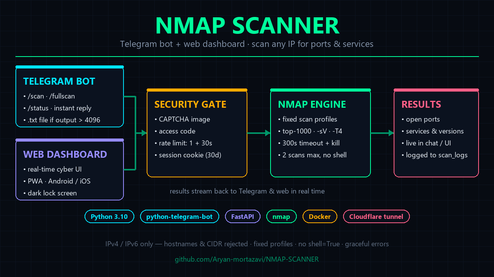

# Nmap Scanner — Web App + Telegram Bot



Scan IP addresses with nmap through a **dark cyber dashboard web app**, or from **Telegram**.
Both share the same hardened scanning engine.


## Features

- **Web app (FastAPI + dark cyber dashboard)**
  - Enter an IP, pick a profile, watch results in a terminal-style viewer
  - Copy / download results as `.txt`, live status polling, cooldown countdown
  - Same security rules as the bot: strict IP validation, blocklist, rate limits
- **Telegram bot (optional)**
  - `/scan <ip>` — fast scan · `/fullscan <ip>` — service detection · `/status`
- **Security**
  - Single IPv4/IPv6 only — hostnames, CIDR, and extra characters rejected
  - No custom nmap arguments — only fixed profiles in a dict
  - Blocklist of forbidden ranges, 300s timeout with process kill
  - Per-client: 1 scan at a time + 30s cooldown; global max 2 concurrent scans
  - `nmap` invoked via `asyncio.create_subprocess_exec` — **never `shell=True`**
  - Scan logging (no secrets ever logged)
  - Optional public mode / user whitelist for the bot

## Prerequisites

- Python 3.10+
- [nmap](https://nmap.org/) installed and in PATH

## Setup

### 1. Configure

```bash
cp .env.example .env
```

Minimal `.env`:

```env
BOT_TOKEN=your_bot_token_here      # only needed for the Telegram bot
PUBLIC_ACCESS=true
```

### 2. Install

```bash
pip install -r requirements.txt
```

### 3a. Run the web app (main interface)

```bash
python app.py
# or: uvicorn app:app --host 127.0.0.1 --port 8000
```

Open **http://127.0.0.1:8000** — interactive API docs at `/docs`.

### 3b. Run the Telegram bot (optional)

```bash
python bot.py
```

| Command | Action |
|---|---|
| `/start`, `/help` | Usage + authorization reminder |
| `/scan <ip>` | Fast scan (`nmap -F -T4`) |
| `/fullscan <ip>` | Service/version detection |
| `/status` | Whether a scan is running for you |

To get a bot token: message [@BotFather](https://t.me/BotFather) → `/newbot`.
To get your user ID: message [@userinfobot](https://t.me/userinfobot).

## Docker

```bash
# Web app only (port 8000)
docker compose up --build -d

# Web app + Telegram bot
docker compose --profile bot up --build -d
```

## Configuration Reference

| Variable | Description | Default |
|---|---|---|
| `BOT_TOKEN` | Telegram bot token (bot only) | — |
| `PUBLIC_ACCESS` | `true` = any user can use the bot | `false` |
| `ALLOWED_USERS` | Comma-separated allowed user IDs (when not public) | — |
| `BLOCKLIST` | Comma-separated CIDR ranges to block | — |
| `ACCESS_CODE` | Access code gating the web app (empty = no restriction) | — |
| `TOTP_SECRET` | TOTP secret for 2FA (empty = no second factor) | — |
| `SCAN_TIMEOUT` | Scan timeout in seconds | `300` |
| `COOLDOWN_SECONDS` | Per-client cooldown between scans | `30` |
| `MAX_CONCURRENT_SCANS` | Global max concurrent scans | `2` |
| `LOG_FILE` | Path to scan log file | `scan_logs.txt` |
| `HOST` / `PORT` | Web app bind address (web only) | `127.0.0.1` / `8000` |

## API

| Method | Path | Body / Query | Returns |
|---|---|---|---|
| `GET` | `/` | — | Dashboard UI |
| `POST` | `/api/scan` | `{"target": "1.2.3.4", "profile": "fast\|full"}` | `{"status": "queued", ...}` |
| `GET` | `/api/status` | — | `{state, target, profile, result, error, cooldown}` |
| `GET` | `/api/health` | — | `{"status": "ok"}` |

Errors: `400` invalid input · `403` blocklisted · `429` rate limited (includes `cooldown`).

## Project Structure

```
nmap-telegram-bot/
├── app.py               # FastAPI web app (API + session state)
├── static/index.html    # Dark cyber dashboard (UI)
├── bot.py               # Telegram bot entry point (optional)
├── scanner.py           # Nmap execution + fixed scan profiles
├── validators.py        # IP validation + blocklist
├── config.py            # Environment loading
├── requirements.txt
├── .env.example
├── Dockerfile
├── docker-compose.yml
└── README.md
```

## Public access (Android / iOS / any browser)

Expose the web app to the internet with a free Cloudflare quick tunnel
(no account needed, HTTPS included):

```bash
# 1. Start the app (HOST=0.0.0.0 in .env)
python app.py

# 2. Start the tunnel (cloudflared.exe included, or get it from cloudflare)
.\cloudflared.exe tunnel --url http://127.0.0.1:8000 --no-autoupdate
```

The command prints a public URL like `https://xxxx-xxxx-xxxx.trycloudflare.com` —
open it from any phone or desktop.

Notes:

- **The URL changes** every time the quick tunnel restarts. For a permanent
  URL, create a free Cloudflare account and a
  [named tunnel](https://developers.cloudflare.com/cloudflare-one/connections/connect-apps/).
- Rate limiting works per real visitor: the app reads `Cf-Connecting-Ip`
  (trusted only from the local tunnel process), so every visitor gets their
  own cooldown/concurrency budget.
- A default `BLOCKLIST` (loopback + private ranges) is set in `.env` so
  visitors cannot probe your own LAN. Edit it if you need to scan your LAN.
- Both processes must keep running; if your machine reboots, start them again
  (or run them via Task Scheduler / as services).

## Web app access control & 2FA

The web app can be locked behind an **access code** plus an optional
**two-step verification (TOTP)** factor, like a private instance of the scanner.

### How login works

0. **Captcha**: type the 5-character code shown in the distorted image —
   generated server-side, one-time use, consumed on every attempt (whether it
   passes or fails), expires after 5 minutes. Keeps automated scripts out.
1. **Step 1 — access code** (`ACCESS_CODE`): something you know.
2. **Step 2 — authenticator code** (`TOTP_SECRET`, optional): a 6-digit code
   that rotates every 30 seconds from Google Authenticator / Authy / 1Password.
3. On success the server issues a `HttpOnly` session cookie (valid 30 days;
   lost on server restart).

Wrong credential attempts are delayed by 1.5s to slow brute force; TOTP is
compared in constant time and accepts ±1 step of clock drift.

### Setup

```bash
# 1. Generate a TOTP secret + QR code
python setup_2fa.py

# 2. Add the printed TOTP_SECRET=... line to .env
# 3. Scan 2fa-qr.png with your authenticator app
# 4. Restart the app
```

- No `ACCESS_CODE` → app is open to everyone (backwards compatible).
- `ACCESS_CODE` set, no `TOTP_SECRET` → single-factor login.
- Both set → two-step verification.
- **Recovery:** if you lose your authenticator, remove `TOTP_SECRET` (or
  `ACCESS_CODE`) from `.env` and restart — you fall back to fewer factors.
- The QR file (`2fa-qr.png`) contains your secret — keep it private
  (it is git-ignored and not served by the app).

## Security Notes

- Only single IP addresses are accepted (no hostnames, no CIDR)
- Users cannot pass custom nmap arguments — only fixed profiles
- Blocklisted IP ranges are rejected before scanning
- Scan requests are logged to a file (bot token is never logged)
- **Always ensure you have authorization before scanning any system**
